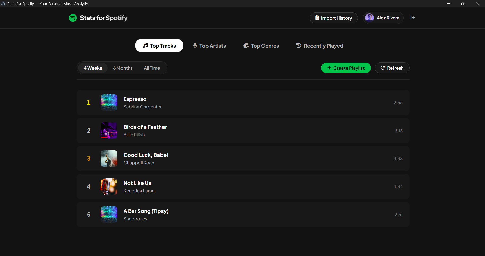
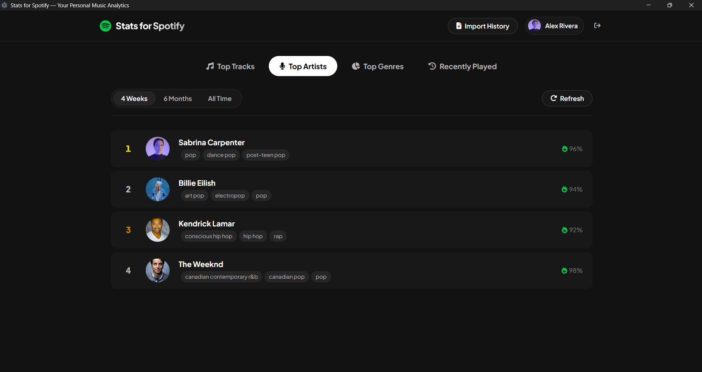
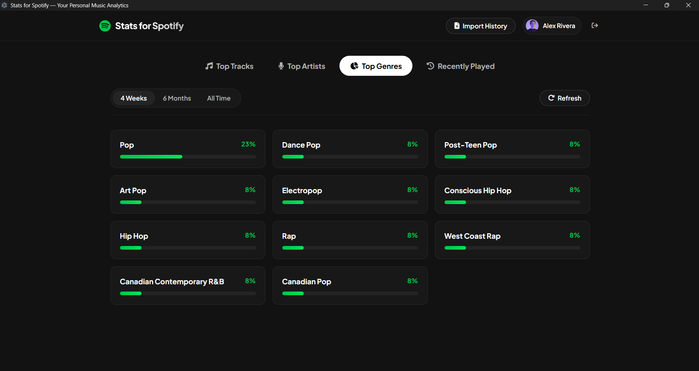
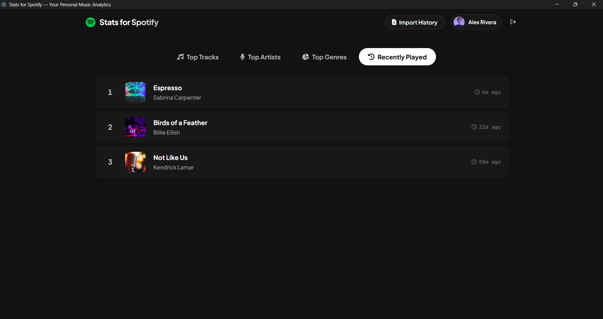

# stats-for-spotify-desktop 🎧

desktop client for statsforspotify because opening the browser is too much effort.

built with electron + vite. no bloat ( jk)

---

### how it looks

<p align="center">
  
  
</p>
<p align="center">
  
  
</p>

---

### features

- **top tracks / artists / genres** across 4 weeks, 6 months, and all time.
- **exact play counts & listening hours**: drop your spotify streaming history json files in and see actual hours/minutes you spent on each artist instead of guessing.
- **1-click playlist creation**: export your top tracks directly to your spotify library.
- **zero passwords stored**: pure oauth 2.0 pkce, runs locally on your machine.
- **interactive demo mode**: test it immediately without logging in.

---

### quick start

#### option 1: lazy way (windows)
just double-click `runapp.bat`. it installs deps, builds, and launches automatically.

#### option 2: terminal way
```bash
# install dependencies
npm install

# launch the app
npm run app
```

---

### how to get exact hours & play counts

spotify hides play counts in their public api, so if you want exact stats:
1. open the app, click **Import History**.
2. click the link to open **Spotify Privacy Settings**.
3. request your **Account data / Extended streaming history**.
4. drag & drop the downloaded `StreamingHistory*.json` files into the app (or click **Auto-Scan Downloads**).
5. done. exact hours, minutes, and play counts will show up instantly.

---

### license
mit. do whatever you want.
